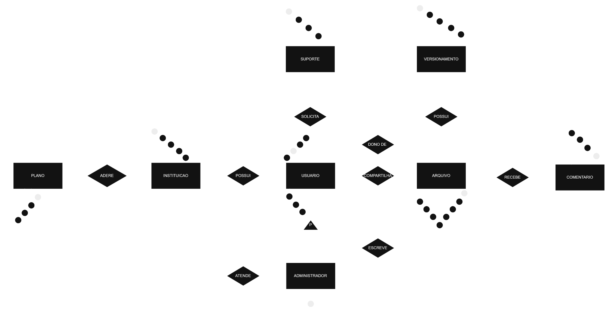
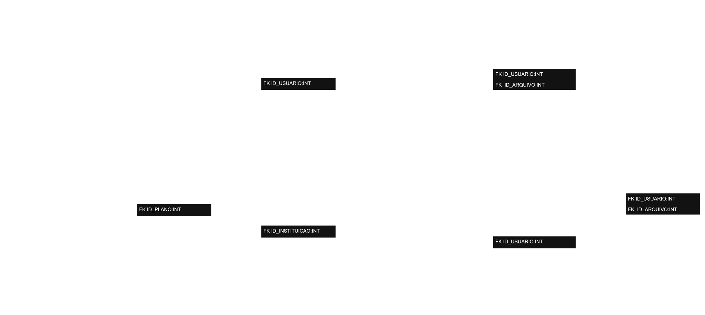

# WebDriver — Banco de Dados

Projeto de modelagem e implementação de um banco de dados para gerenciamento de arquivos, usuários e instituições, com compartilhamento, comentários, suporte e histórico de operações.

## Modelos

### Modelo conceitual

### Modelo lógico

### Modelo físico

O script [01-modelo-fisico.sql](sql/01-modelo-fisico.sql) implementa a estrutura em MySQL 8.0.16 ou superior.

## Estrutura

| Caminho | Conteúdo |
|---|---|
| `docs/modelo-conceitual/` | Diagrama conceitual |
| `docs/modelo-logico/` | Diagrama lógico |
| `sql/` | Implementação física |

## Recursos implementados no script

- Instituições e planos com limite de armazenamento por usuário.
- Usuários e administradores.
- Arquivos e compartilhamentos.
- Comentários e chamados de suporte com múltiplos administradores.
- Histórico de operações e metadados de versões.
- Exclusão lógica de arquivos.
- Procedimentos para carregar, atualizar e remover arquivos.
- Triggers para validações de acesso e cotas.

## Como executar

1. Instale MySQL 8.0.16 ou superior e abra o MySQL Workbench.
2. Conecte-se a uma instância de desenvolvimento.
3. Abra `sql/01-modelo-fisico.sql`.
4. Execute o script em um banco novo. Ele cria e seleciona o banco `webdriver`.

O script não foi executado em MySQL nesta preparação. Reexecutá-lo após criar as tabelas causará erros de objetos existentes.

## Regras e limites

Cada instituição possui um plano atual. Um chamado pode ser associado a vários administradores. As alterações em arquivos devem passar pelos procedimentos para aplicar cotas e registrar histórico. Autenticação, hash de senha e permissões da conta do banco precisam ser configurados pela aplicação e pelo responsável pelo ambiente. O histórico de metadados não substitui a preservação dos arquivos de versões anteriores.

## Arquivos editáveis dos diagramas

- [Modelo conceitual no Drive](https://drive.google.com/file/d/1purrhiVyhfNTFOg3Qon34gkXQpi7SYsP/view)
- [Modelo lógico no Drive](https://drive.google.com/file/d/1WD-crls5wBHvUXtBlZt8xxZJQfTUF5Bc/view)

Os arquivos `.drawio` não estão incluídos neste pacote. Os links foram fornecidos pelo autor e podem apontar para versões anteriores às imagens.
